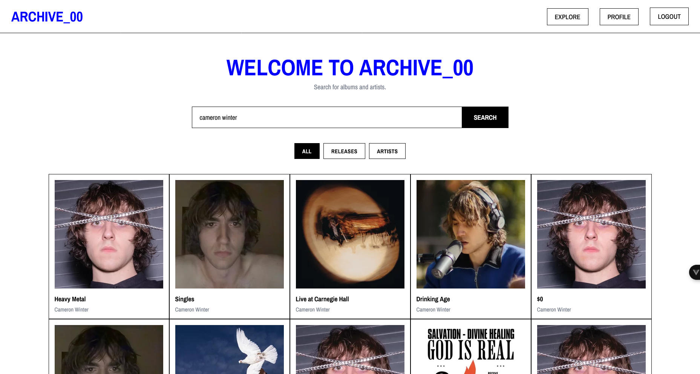
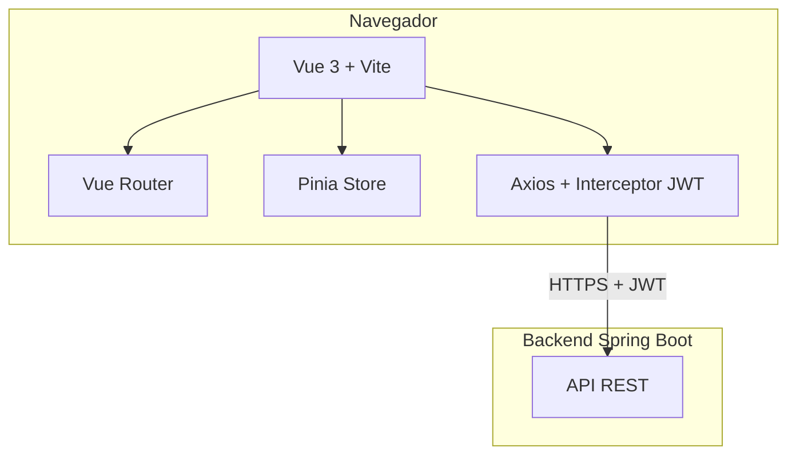
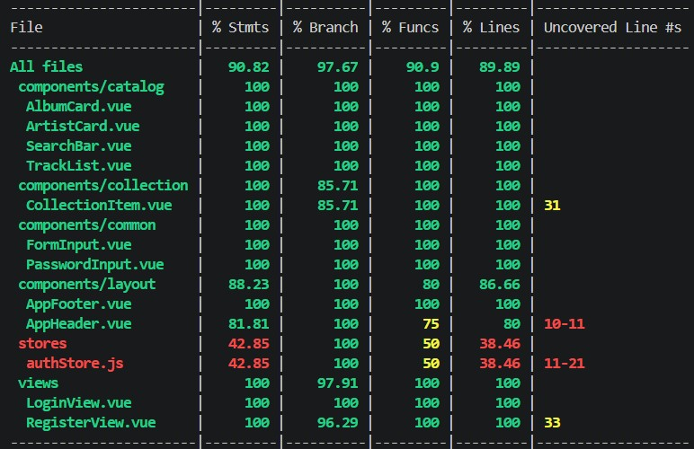

# Archive_00 — Frontend

Aplicación web para explorar, guardar y reseñar música. Construida con Vue 3, Vite y Tailwind CSS.



## Descripción

Archive_00 es una aplicación web que permite a los usuarios:

- Buscar álbumes y artistas (a través de la API de Last.fm).
- Guardar álbumes con una puntuación de 1 a 5 estrellas.
- Añadir álbumes a una lista de "escuchar más tarde" (Archive).
- Escribir reseñas personales.
- Ver y gestionar su colección personal desde su perfil.

Este repositorio contiene el **frontend** (SPA en Vue 3). El backend está en [este repositorio](https://github.com/simoneavilarranz/p5-digital-academy-project-archive00-backend).

---

## Stack Tecnológico

- **Vue 3** + **Vite**
- **Vue Router** (navegación)
- **Pinia** (gestión de estado)
- **Tailwind CSS v4** (estilos)
- **Axios** (cliente HTTP)
- **Vitest** + **Vue Test Utils** (testing)
- **ESLint** + **Prettier** (calidad de código)

---

## Requisitos Previos

Antes de arrancar el frontend, asegúrate de tener instalado:

- **Node.js 22** o superior.
- **npm 10** o superior.
- **El backend corriendo en `http://localhost:8080`**.

---

## Instalación y Ejecución

### 1. Clonar el repositorio

```bash
git clone https://github.com/simoneavilarranz/p5-digital-academy-project-archive00-frontend.git
cd p5-digital-academy-project-archive00-frontend
```

### 2. Instalar dependencias

```bash
npm install
```

### 3. Configurar variables de entorno

Copia el archivo `.env.example` a `.env`:

```bash
cp .env.example .env
```

El archivo `.env` debe contener:

```
VITE_API_BASE_URL=http://localhost:8080/api
```

### 4. Arrancar el frontend

```bash
npm run dev
```

La aplicación estará disponible en **`http://localhost:5173`**.

<!-- AQUÍ CAPTURA: Terminal con "VITE ready in X ms" -->

---

## Scripts Disponibles

| Comando                 | Descripción                              |
| :---------------------- | :--------------------------------------- |
| `npm run dev`           | Servidor de desarrollo.                  |
| `npm run build`         | Build de producción.                     |
| `npm run preview`       | Previsualizar el build.                  |
| `npm run test:unit`     | Ejecutar tests con Vitest.               |
| `npm run test:coverage` | Ejecutar tests con informe de cobertura. |
| `npm run lint`          | Ejecutar ESLint + Oxlint.                |
| `npm run format`        | Formatear código con Prettier.           |

---

## Estructura del Proyecto

```
src/
├── assets/              # Imágenes, fuentes, estilos globales
├── components/          # Componentes reutilizables
│   ├── catalog/         # AlbumCard, ArtistCard, SearchBar, TrackList
│   ├── collection/      # CollectionItem
│   ├── common/          # FormInput, PasswordInput
│   └── layout/          # AppHeader, AppFooter
├── views/               # Vistas (páginas)
│   ├── HomeView.vue
│   ├── LoginView.vue
│   ├── RegisterView.vue
│   ├── ProfileView.vue
│   ├── AlbumDetailView.vue
│   └── ArtistDetailView.vue
├── services/            # Servicios HTTP
│   ├── apiClient.js     # Cliente Axios con interceptor JWT
│   ├── authService.js
│   ├── catalogService.js
│   ├── collectionService.js
│   └── userService.js
├── stores/              # Pinia
│   └── authStore.js
├── router/              # Vue Router
│   └── index.js
├── styles/              # CSS global
│   └── main.css
├── App.vue              # Componente raíz
└── main.js              # Punto de entrada
```

---

## Funcionalidades

### Autenticación

- Registro con validación (email, contraseña, confirmación).
- Login con JWT.
- Sesión persistente en LocalStorage.
- Header dinámico según el estado de sesión (LOGIN / PROFILE / LOGOUT).

### Catálogo (Last.fm)

- Búsqueda de álbumes y artistas.
- Filtros por tipo (ALL / RELEASES / ARTISTS).
- Detalle de álbum con portada, descripción y tracklist.
- Detalle de artista con bio e imagen.
- Grid responsive (2-5 columnas).

### Colección Personal

- Guardar álbumes con rating (1-5 estrellas) y reseña opcional.
- Añadir a "Escuchar más tarde" (Archive).
- Eliminar ítems desde el perfil.
- Perfil con info del usuario, contadores y dos columnas (Collection + Archive).

### Navegación

- Preservación de la búsqueda en la URL (`?q=radiohead`).
- Enlace directo del artista desde el detalle del álbum.
- Rutas protegidas (algunas ocultan el Header y Footer).

---

## Rutas

| Ruta                    | Vista              | Descripción                     |
| :---------------------- | :----------------- | :------------------------------ |
| `/`                     | `HomeView`         | Búsqueda de álbumes y artistas. |
| `/login`                | `LoginView`        | Inicio de sesión.               |
| `/register`             | `RegisterView`     | Registro de usuario.            |
| `/profile`              | `ProfileView`      | Perfil con colección y archive. |
| `/album/:artist/:album` | `AlbumDetailView`  | Detalle de un álbum.            |
| `/artist/:name`         | `ArtistDetailView` | Detalle de un artista.          |

**Nota:** las rutas `/login` y `/register` tienen `meta: { hideHeader: true, hideFooter: true }`.

---

## Arquitectura



---

## Conexión con el Backend

El frontend se comunica con el backend mediante **Axios**, con un **interceptor** que añade automáticamente el JWT a cada petición:

```javascript
apiClient.interceptors.request.use((config) => {
  const authStore = useAuthStore()
  if (authStore.token) {
    config.headers.Authorization = `Bearer ${authStore.token}`
  }
  return config
})
```

La URL base del backend se configura en el archivo `.env`:

```
VITE_API_BASE_URL=http://localhost:8080/api
```

**Importante:** el backend debe estar corriendo para que el frontend funcione.

---

## Tests

El proyecto tiene **49 tests** con una cobertura del **90%**.

### Tests de componentes

- `AppHeader.spec.js` → logo, navegación, estado de sesión.
- `AppFooter.spec.js` → enlaces y copyright.
- `FormInput.spec.js` → input reutilizable.
- `PasswordInput.spec.js` → input con toggle de visibilidad.
- `AlbumCard.spec.js` → tarjeta de álbum.
- `ArtistCard.spec.js` → tarjeta de artista.
- `SearchBar.spec.js` → barra de búsqueda.
- `TrackList.spec.js` → lista de pistas.
- `CollectionItem.spec.js` → ítem de colección.

### Tests de vistas

- `LoginView.spec.js` → formulario, errores, llamada al servicio.
- `RegisterView.spec.js` → validación, errores, redirección.

### Ejecutar los tests

```bash
npm run test:unit
```

Para ver el informe de cobertura:

```bash
npm run test:coverage
```



---

## Sistema de Diseño

El proyecto usa **Tailwind CSS v4** con un sistema de diseño personalizado:

- **Colores:** blanco, negro, gris claro, gris medio y azul cobalto.
- **Tipografías:** Archivo Narrow (principal) y Roboto Mono (monoespaciada).
- **Estilo:** brutalista / archivístico (bordes marcados, mucho espacio en blanco, tipografía en mayúsculas).

Los colores y fuentes se definen en `src/styles/main.css` con la directiva `@theme` de Tailwind v4:

```css
@theme {
  --color-blue: #0000ff;
  --color-gray-light: #f5f5f5;
  --color-gray-medium: #e2e2e2;
  --font-sans: 'Archivo Narrow', sans-serif;
  --font-mono: 'Roboto Mono', monospace;
}
```

## Enlaces

- [Backend Repository](https://github.com/simoneavilarranz/p5-digital-academy-project-archive00-backend)

---

## Autora

Simone Ávila Arranz
